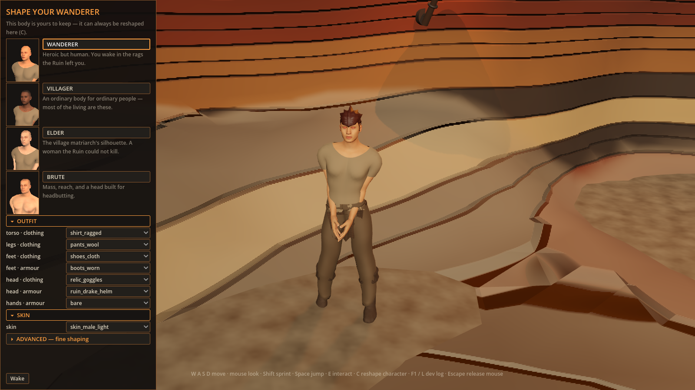

# Frames for the two previews that had none (#1457)

The [preview judgement page](../../previews/README.md) links each pending preview to
the frames that already exist for it. Two previews had no committed frames, so these
were captured for that page with the existing `client/tools/frame_capture.gd`.

All five are whole, unretouched 1600×900 frames from the source client at `main`
`427bd04`: Godot 4.7.1, Metal 4.0 Forward+, Apple M2 Pro, `VOLUMETRICS on`. Every run
printed `BOOT_OK` and `CAPTURE PASS`, and redirected the character save, progression
vault and boot-recovery ledger to disposable paths. The development HUD is not a
release receipt.

## Layered outfit pickers (`WAR_LAYERED_OUTFIT_PICKERS`, #336)

`WAR_SCENARIO=first_run` with no save present, so the first-run creator opens. The
`first_run_outfit` frame scrolls to the wardrobe controls.

| Switch off | `WAR_LAYERED_OUTFIT_PICKERS=1` |
|---|---|
|  |  |

With the switch on, the creator offers one row per region and layer, including the
head, feet and hand armour pieces. The rows still show raw piece names such as
`ruin_drake_helm` and `bare`.

## Contextual control hints (`WAR_CONTEXTUAL_HINTS`, #459)

`WAR_SCENARIO=world WAR_WORLD_VANTAGE=shrine`, with a disposable copy of
`client/recipes/wanderer.json` as the save. The opted-in run sets
`WAR_HINT_DWELL_SECONDS=0.5`, so the frame is taken after the hint bar has faded.

| Switch off | `WAR_CONTEXTUAL_HINTS=1` |
|---|---|
|  |  |

With the switch off, every control is listed along the bottom of the frame for as
long as the game runs. With it on, the bar shows, stays for the dwell time, then fades,
and a small `[H] controls` label at the bottom right brings it back.
