# Issue #1461 — the predicted wanderer stopping under a delayed zone

These frames show where the predicted wanderer is drawn, frame by frame, as it
stops under the same scripted zone `predicted_body_test` uses: intents take one
30 Hz tick to reach the zone and acknowledgements two to come back (a three-tick
round trip). The drawn position is `PredictedBody.display_position()`, which
`Player.apply_predicted` uses to place the wanderer in a server trial. The
stage is a bare sand plane with a post where the zone finally stops the body,
so a slide after the stop reads against the post. The body holds its standing
pose: these frames judge where it is drawn, not how it animates.

Captured with `client/tools/predicted_motion_capture.tscn` (Godot 4.7.1,
Metal Forward+, Apple Silicon Mac mini), windowed at 1280×720, halved. "Before"
is the same tool with `main`'s prediction scripts.

## A three-tick round trip

The input stops at frame 60.

| Frame | Before (drawn x) | After (drawn x) |
|---|---|---|
| 56 | 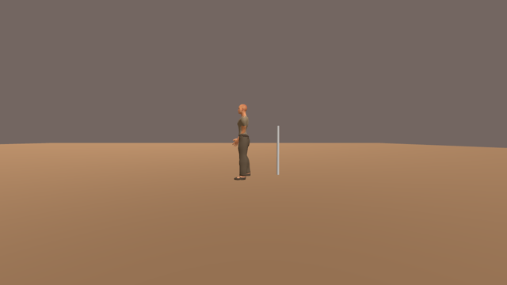 | 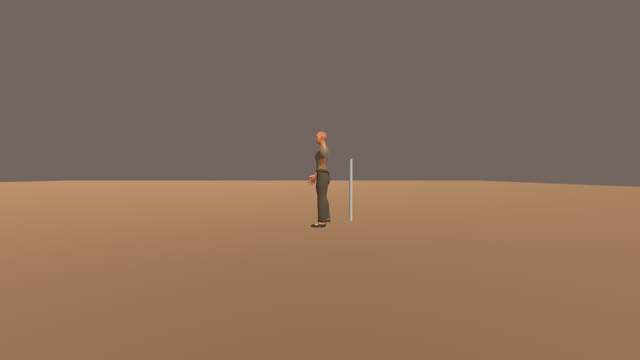 |
| 60 | 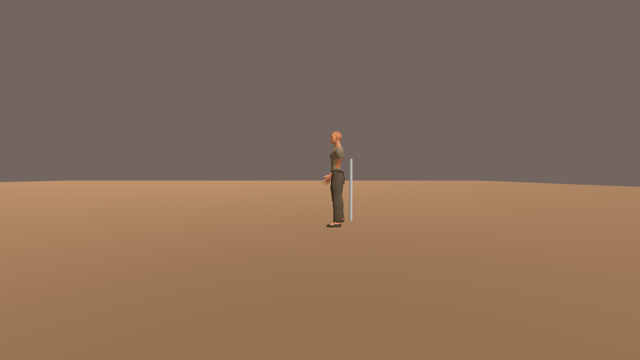 | 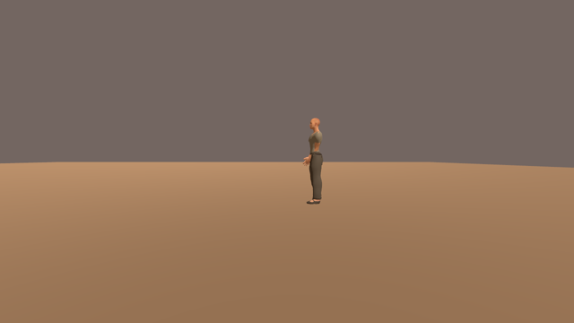 |
| 64 |  |  |
| 68 |  | 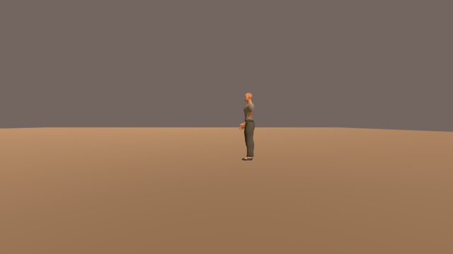 |

Before, the body lags the input by about a round trip and keeps moving after
the stop: 6.783 m at frame 56, 7.315 m when the input stops, reaching the
zone's 7.581 m only at frame 64 (two corrections of 133 mm). After, it is drawn
at 7.581 m from the frame the input stops and never moves again.

## After a one-second zone stall

The zone stalls for 30 frames from frame 50 and then runs only its eight
catch-up steps; the input stops at frame 120.

| Frame | Before | After |
|---|---|---|
| 118 |  | 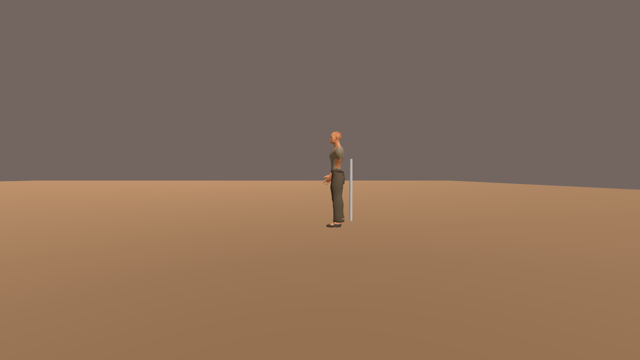 |
| 124 | 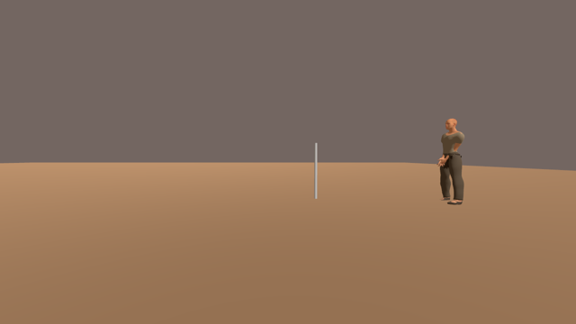 |  |
| 130 | 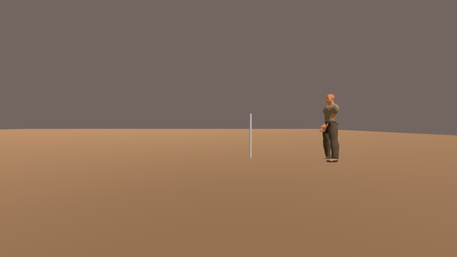 | 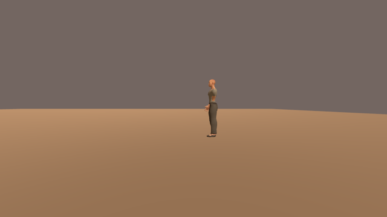 |
| 136 | 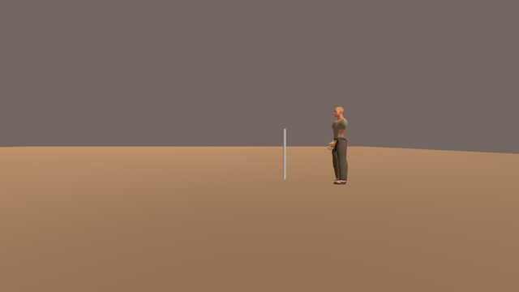 |  |
| 142 | 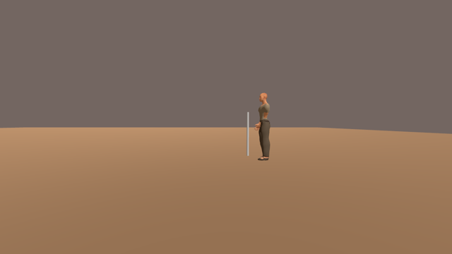 |  |

Before, the body runs on past the post to 14.630 m and is then pulled back
2.8 m over the next second (13.822 m at frame 130, 12.502 m at 140). After, the
stall's lost travel is corrected once when the zone comes back, and the body
stops at the post (11.837 m) with no slide.

## Reference and gap

Motion reference: the character-motion anchor in
[`docs/art-direction/`](../../art-direction/README.md), *Kingmakers* Official
Announcement Trailer **1:06–1:10**, cue: a sprinting body that stops where its
player stops it, with the camera keeping it readable. Before falls short (the
body slides on and back after the stop); after matches the cue for position.
No reference media is committed or used as input.

**Remaining gap:** this is a scripted zone on a bare stage, and the body is
placed, not animated; the stop itself is still an unauthored transition. On a
loopback server the round trip is about one tick, so an ordinary windowed trial
looks the same before and after. The feature stays behind the default-off
`WAR_ZONE_MOVEMENT=1 WAR_PREDICTED_MOVEMENT=1` trial switches.

**Originality:** first-party code and captures only.
