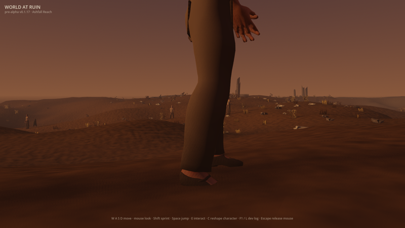
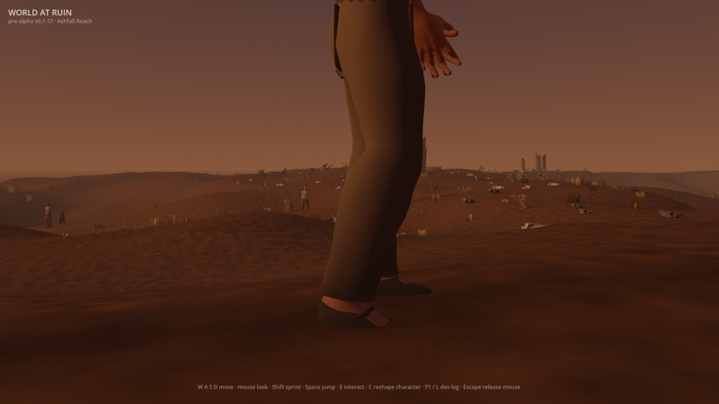
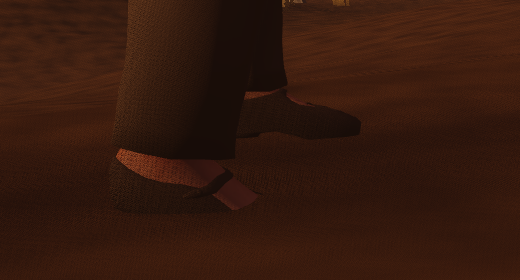
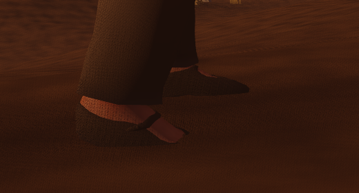

# Issue #1638 — the standing pose rests both feet on the terrain

Before this change, a wanderer standing still on uneven ground kept each foot at
the height of the body's own flat ground plane, so one foot sank into the ground
and the other hovered over it. The planted gaits (#909) already stood their
feet on the terrain; the standing pose did not.

Now, with either gait preview opted in (`WAR_WALK_CYCLE=1` or `WAR_RUN_CYCLE=1`),
the standing pose samples the ground under each ankle with the same sampler the
gaits use, raises or lowers each ankle by how far that ground stands off the
body's plane, and lowers the pelvis by the deeper foot's offset so that leg
still reaches. On flat ground, where no ground is sampled (a cave, the terrain's
edge) or where the body is not standing on the sampled ground, the pose is the
rest pose bit for bit. Walking off and stopping ease the terrain offsets over the
gaits' 0.15 s instead of jumping. With neither preview opted in nothing changes:
the standing pose ships today.

## Measured through the real controller (2026-11-10)

`WAR_SCENARIO=gait_drive` with both gait opt-ins (see
[#516's evidence](../issue-516-gait-drive/README.md)). Host: Apple Silicon Mac
mini, Metal Forward+, Godot 4.7.1, `client/recipes/wanderer.json`. "Before" is
`main` at `6349106` on the same host and run setup.

| | Left ankle over the terrain at rest | Right ankle | Lowest walk / run foot reading | A down foot moves at (walk / run) |
|---|---|---|---|---|
| before | 9.09 cm | 6.98 cm | −1.1 cm / −1.1 cm | 7% / 5% of body speed |
| after | 7.98 cm | 7.75 cm | −0.0 cm / −0.0 cm | 5% / 5% of body speed |

Both ankles stand 8.0 cm over flat ground. The drive measures every lift against
the standing pose at the spawn point, so the −1.1 cm baseline #909 recorded is
gone. The 2.5 mm left on the right ankle is well inside the 1 cm bound; the drive
reads the smooth terrain height, while the feet are planted on the walkable
height the body is kept on. `planted_feet_test` measures the standing plant on an
exact 15° plane, along and across it and with the body turned, scaled and lifted,
and holds each ankle to within 0.01 mm of its standing height above the ground.
The trace fingerprint changes, because the feet stand differently, to
`6b4f9c731f835df05d1ed6ddd7ec9d092e247bbde27da66efefcb827557b6ae5`.

## Frames

The drive's new standing frame, side-on at ankle height before any input,
halved, and a crop of the feet at full size. The spawn point slopes gently, so
the change is a few centimetres: the near (left) foot comes down onto the sand
and the far (right) foot rises onto it.

| | Before | After |
|---|---|---|
| Standing |  |  |
| Feet |  |  |

Reference: the drive's own cue, *Kingmakers* Official Announcement Trailer
1:06–1:10 (full-body stride and camera tracking), as recorded in
[`docs/art-direction/`](../../art-direction/README.md). The cue judged here is a
body that bears its weight on the ground under it; no reference media is
committed or used as input.

**Originality:** first-party code and captures only. The standing plant reuses
World at Ruin's own sagittal two-bone leg solve and its own terrain sampler; no
reference pose, timing or staging was copied.

## Remaining gap

- The feet follow the terrain's height, not its tilt: on a slope the sole meets
  the ground at the ankle, not along its whole length.
- Only the heightfield (and raised stone, with its preview) is sampled; a body
  standing on a ruin or rock less than about 0.22 m above the terrain still
  rests its feet on the terrain inside it.
- The gait's own first pose still snaps from the standing pose (pelvis drop and
  leg angles), as it did before; only the terrain offsets ease. Authored starts
  and stops remain unauthored.
