# Issue #1639 — smoother terrain-plant transitions in the gait previews

#909 planted the walk and run previews' feet on the terrain, and #1638 the
standing pose. Their review left small transition gaps, all inside the
default-off previews (`WAR_WALK_CYCLE=1`, `WAR_RUN_CYCLE=1`). This change closes
them without moving the steady-state plant:

1. **The pelvis eases with the feet.** The pelvis drop the ground asks for now
   applies through the body's own weight on the terrain, which eases over the
   same 0.15 s as each foot's. Before, the drop moved at a fixed 2 m/s, so a
   typical 8 cm drop left in a few ticks while the feet took nine, and for those
   ticks the downhill stance foot was out of reach and lifted.
2. **A step under a foot is spread over several ticks.** Ground the body moves
   over changes a sample by about the same amount every tick, however fast the
   foot travels. A raised stone's lip instead steps it by the lip's height in one
   tick. A change that differs from the previous tick's by more than the ease
   allows is held back and released at that ease, for each foot's ground target
   and for the pelvis drop, while smooth changes pass through untouched.
3. **The body-on-ground tolerance follows the floor under the body.** The player
   now derives it each tick from its floor normal, r·(1/n.y − 1) plus 5 cm,
   instead of the steepest walkable floor's 0.216 m everywhere. On level ground
   it is 5 cm and at 10° it is 5.6 cm, so a body standing 0.2 m up on a rock or
   ruin on gentle ground no longer plants its feet on the terrain inside it.
   Airborne, or on the steepest floor, it is the old 0.216 m.

## Measured

`planted_feet_test`, at 120 ticks a second on the shipped wanderer rig:

- Fading on and off a 15° slope, for both feet and then for one foot only,
  each ankle moves at most 1.34 cm a tick beyond the same walk with no ground
  sampled (bound 1.77 cm, the ease plus a millimetre). The pelvis fades over 17
  ticks with the feet, and no planted foot lifts off its eased ground.
- An 8 cm lip passing under the feet moves each ground target and the pelvis
  drop at most 1.67 cm a tick (the ease), where before it moved 8 cm in one tick.
- Each check fails against the previous behaviour: without the step spreading,
  the lip moves a target 8.00 cm in one tick; with the pelvis easing faster than
  the feet, it moves 2.02 cm in one tick as the ground comes and goes.

The controller-driven `gait_drive` (Godot 4.7.1, Metal Forward+, Apple Silicon
Mac mini) is unchanged: the same contact, slide and cadence numbers, and the
same trace fingerprint
`6b4f9c731f835df05d1ed6ddd7ec9d092e247bbde27da66efefcb827557b6ae5` before and
after. Its line crosses no lip and never loses the ground, so the steady-state
plant is exactly what it was.

## Frames

Side-on at ankle height along the drive (`WAR_GAIT_DRIVE_SIDE=1`, a local
capture option; CI keeps its three-quarter frames), cropped to the feet and
halved: the walk's frames 0–6 and the run's 14–20. The before frames are the
#1638 branch this builds on. The two columns are the same pose; the feet meet
the sloping sand the same way, which is the point: nothing in the steady plant
moved.

| Frame | Before | After |
|---|---|---|
| walk 0 |  | 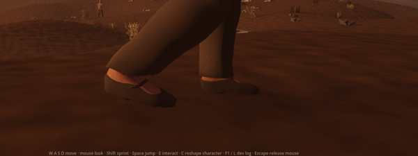 |
| walk 2 |  | 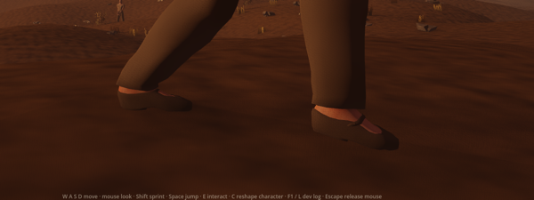 |
| walk 4 |  | 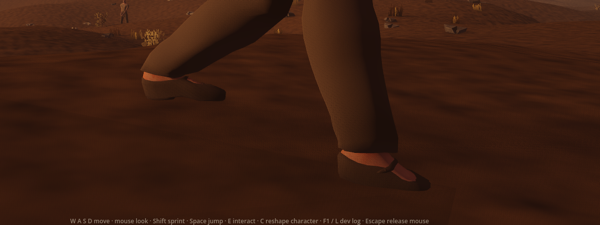 |
| walk 6 | 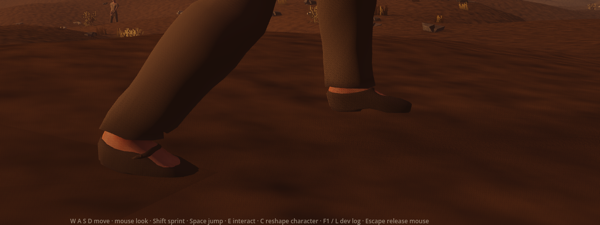 |  |
| run 14 |  | 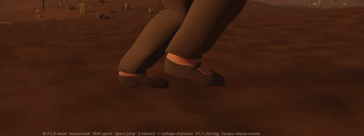 |
| run 16 | 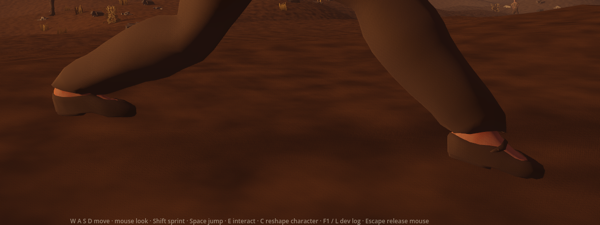 |  |
| run 18 | 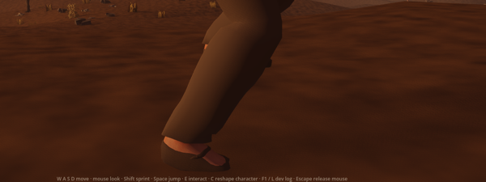 |  |
| run 20 |  | 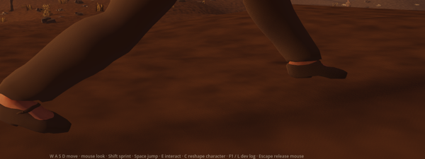 |

## The transitions that changed, in motion

`client/tools/plant_transition_capture.tscn` drives the walk preview's
`WalkLocomotion` directly along +X at 2 m/s on a bare stage and photographs it
side-on at ankle height every third 60 Hz tick (0.05 s apart), windowed at
1280×720, cropped and halved. "Before" is the same tool with `main`'s
locomotion and player scripts (which already carry #1638). Frame numbers are
ticks since the walk started.

**An 8 cm stone lip** at x = 0, crossed by the swinging and then the planted
feet. Before, a foot's ground target jumps the lip's height in the tick it
crosses; after, it rises over a few ticks.

| Tick | Before | After |
|---|---|---|
| 24 |  | 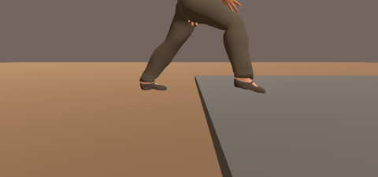 |
| 27 | 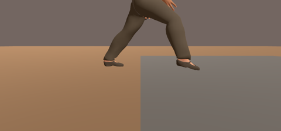 |  |
| 30 | 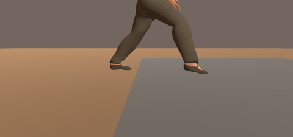 | 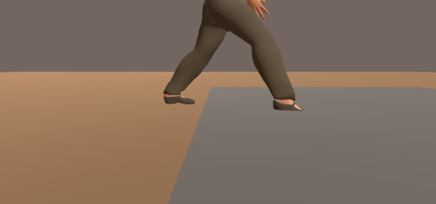 |
| 33 | 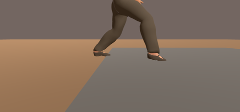 | 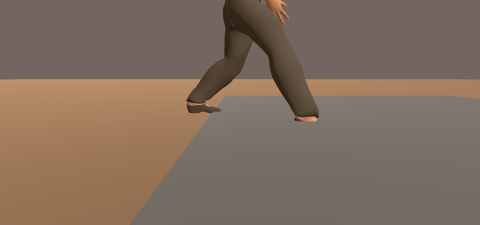 |
| 36 | 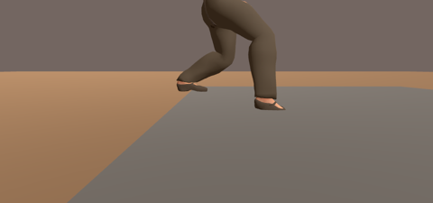 | 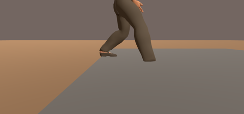 |

**Ground that cannot be sampled**: the walk leaves a 15° slope that runs across
the body (one foot higher than the other) for a cave-style floor that answers no
height at x = 0. Before, the pelvis left the slope's drop in a few ticks while
the feet took nine, so the downhill foot was briefly out of reach; after, the
pelvis and both feet fade together over 0.15 s.

| Tick | Before | After |
|---|---|---|
| 24 | 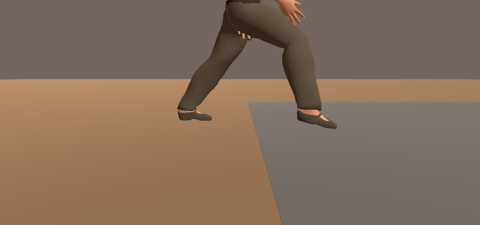 |  |
| 27 | 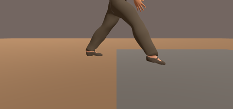 | 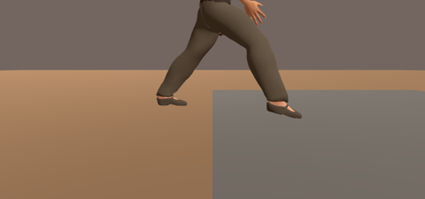 |
| 30 | 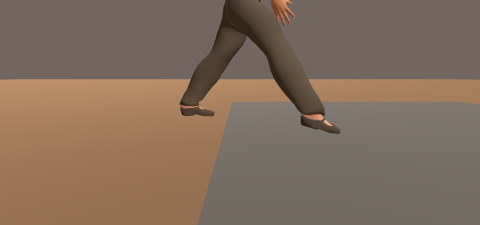 | 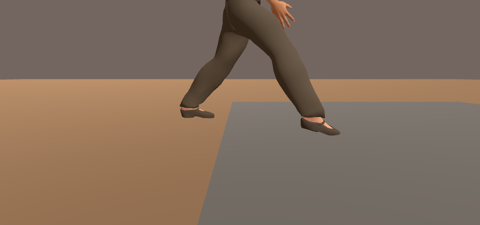 |
| 33 | 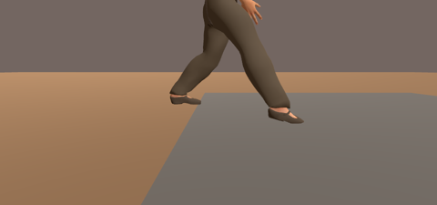 | 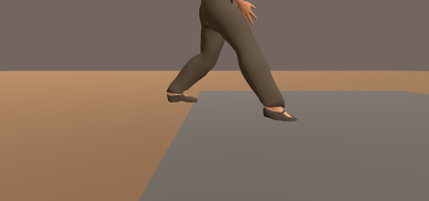 |
| 36 |  | 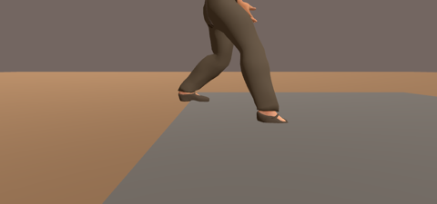 |
| 39 |  | 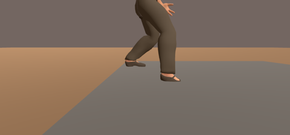 |

**Standing 0.2 m up on a flat rock** over level terrain (the standing pose under
the walk preview). Before, the steepest-floor tolerance of 0.216 m counted the
body as standing on the terrain inside the rock, so both feet were planted
inside the stone; after, the tolerance on a level floor is 5 cm, and the feet
stand on the rock.

| Tick | Before | After |
|---|---|---|
| 3 |  |  |
| 15 | 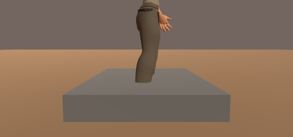 | 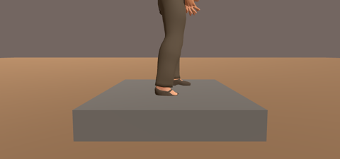 |
| 30 |  |  |

These stages are bare boxes and planes: they judge where the feet go, not the scene.

Reference: the drive's own cue, *Kingmakers* Official Announcement Trailer
1:06–1:10 (full-body stride), as recorded in
[`docs/art-direction/`](../../art-direction/README.md). No reference media is
committed or used as input.

**Originality:** first-party code and captures only; the changes are World at
Ruin's own easing of its own terrain sampler.

## Remaining gap

- The feet follow the terrain's height, not its tilt.
- Only the heightfield (and raised stone, with its preview) is sampled.
- A foot that touches down within a few ticks of crossing a lip lands slightly
  short of the stone's height and settles onto it over those ticks.
