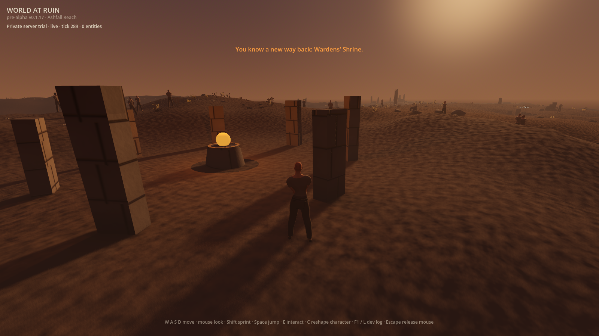
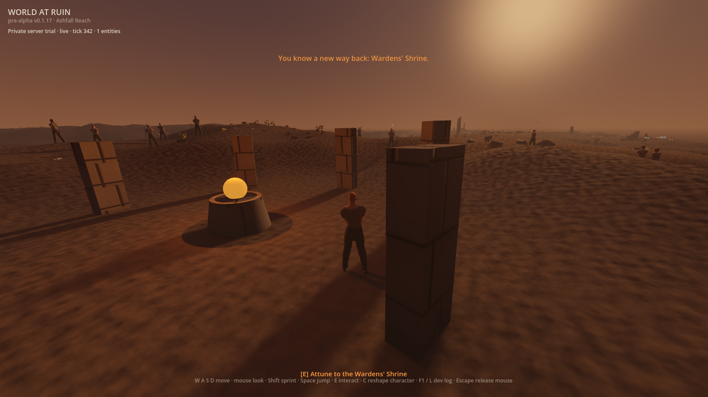
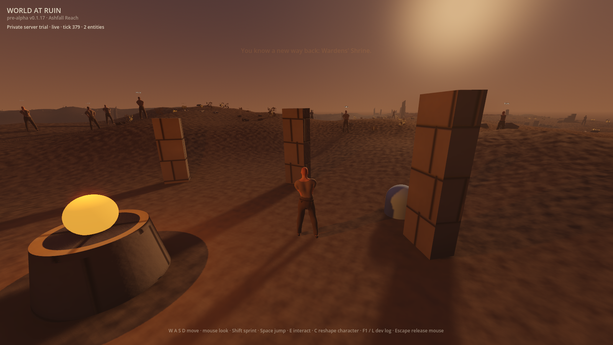
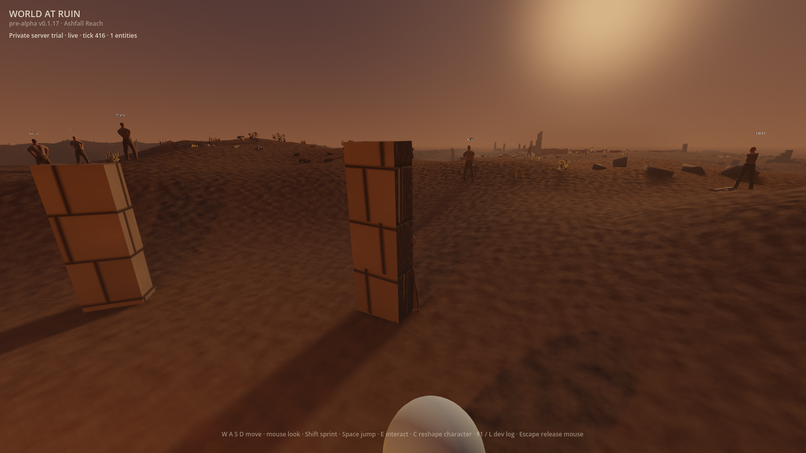
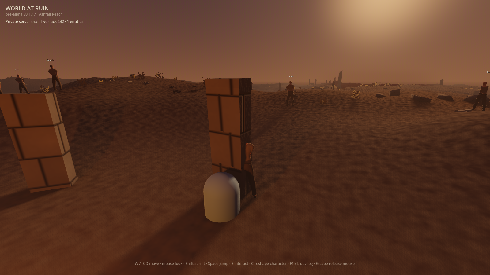

> 🤖 Generated by the Agentic Engineer

# The predicted wanderer moving under the shipping HUD (#812)

These raw, ungraded 1600×900 frames come from one windowed run of the ordinary
launch scene (`res://scenes/main.tscn`) with Godot 4.7.1 and Metal Forward+ on
an Apple M2 Pro. The client is connected to a zone built from this branch
(`server/cmd/zone -listen 127.0.0.1:<port> -movement-intents`). Both switches
are on: `WAR_ZONE_MOVEMENT=1 WAR_PREDICTED_MOVEMENT=1`. The character, vault and
recovery saves use disposable paths.

The run prints `PREDICTED_MOVEMENT_ACTIVE` before the first frame. The HUD then
reads `Private server trial · live`. A small harness holds `move_forward` and
`sprint` through Godot's ordinary `Input` actions for three seconds, then
releases them. It photographs the frames after each drawn frame.

| Moment | Frame | Wanderer position (x, z) |
|---|---|---|
| Standing, 2 s after the zone went live |  | (−7.261, 0.985) |
| Forward + sprint held 1 s |  | (−3.597, 2.344) |
| Held 2 s |  | (0.027, 3.689) |
| Held 3 s |  | (3.627, 5.024) |
| 0.6 s after release |  | (3.403, 4.941) |

**What this shows.** The body moves the moment the controls are held, and it
keeps moving under the zone's acknowledgements: 11.613 m in 3.0 s, or about
3.87 m/s against the demo zone's 4 m/s cap. Prediction stays active in every
frame, and no refusal latches. The shrine, the HUD, the hints and the
trial status line render as they do in a single-player boot.

## Remaining gaps

These frames also show where predicted movement still falls short. The switch
is off by default, so none of this reaches a shipped boot.

1. **The predicted body walks through solid ruins.** Between 2 s and 3 s the
   wanderer walks into a stone pillar, and it stands half inside it after
   release. The prediction has no collision step yet, per ADR 0026. With
   prediction off, the same input stops at a wall under local physics (see
   [the control frame](control-local-physics-held-3s.png); that run spawned in
   a cave, so its view is not the same).
2. **A replica capsule is drawn beside the wanderer.** From 1 s on, the HUD
   counts one or two replicated entities. A plain capsule appears next to the
   wanderer, and after release it sits just behind it. This is most likely the
   zone's own copy of the player, drawn by `ReplicaView`, which draws every
   replicated entity. That behaviour predates this change, but with prediction
   on it reads as a second body following you.
3. **Release settles back.** After release the body moved 0.239 m back toward
   the zone's answer, within the 100 ms correction decay. An earlier headless
   run on the same head recorded 0.028 m. #813 is the measurement for this.

## Control

The same harness and zone, with only `WAR_PREDICTED_MOVEMENT` unset, kept
`predicted=false` throughout. Local physics moved the wanderer 6.515 m, then
stopped it at a cave wall.

## Reproduce

1. Build the zone from `server/` with `go build ./cmd/zone`.
2. Issue a throwaway local CA and a server certificate for an FQDN, for example
   `zone.example.test`. The client refuses a bare `localhost` identity.
3. Mint a token with `zone -allocation-id <id> -mint-token 1`, using a random
   `WAR_ZONE_ADMISSION_SECRET`. Serve with
   `-listen 127.0.0.1:<port> -tls-cert … -tls-key … -movement-intents`.
4. Point Godot at the throwaway CA through an untracked `client/override.cfg`.
   It sets `network/tls/certificate_bundle_override`, so no system trust store
   changes.
5. Boot the game with `WAR_ZONE_URL=wss://127.0.0.1:<port>/zone`,
   `WAR_ZONE_TLS_SERVER_NAME=zone.example.test`, `WAR_ZONE_TOKEN`, both
   movement switches and the three save seams.

The harness instantiates `main.tscn` and waits for `_zone.is_live()`. It then
presses and releases the actions with `Input.action_press` and
`Input.action_release`, and saves `get_viewport().get_texture().get_image()`
after `RenderingServer.frame_post_draw`. It was not committed: its only job was
to replace the keyboard.
