# Issue #909 — planted feet stand on the terrain under them

Before this change a planted foot held its place on the body's own flat ground
plane. Over real terrain that plane is not where the ground is, so on the
controller-driven drive a planted foot sank into rising ground and hung over
falling ground, and on downhill stretches a foot that should be down counted as
lifted.

Now `WalkLocomotion` asks the controller for the ground height under each foot
(the same walkable height the body is kept on) and raises or lowers each foot by
how far that ground stands above or below the body's plane, the floor its soles
touch at rest. The pelvis drops by how far the ground at the deeper end of a
stance lies below that plane, so the downhill leg still reaches without the body
bobbing from step to step. Where there is no ground to sample (inside a cave
system, off the terrain's edge), or the body stands well off the sampled ground,
both offsets are zero and the gait is exactly the flat-plane one; when that
changes mid-stride, the feet and pelvis ease between the two over 0.15 s. Both
gaits stay default-off behind `WAR_WALK_CYCLE=1` and `WAR_RUN_CYCLE=1`.

## Measured through the real controller (2026-11-04)

`WAR_SCENARIO=gait_drive` with both gait opt-ins (see
[#516's evidence](../issue-516-gait-drive/README.md) for how the drive works).
Host: Apple M2 Pro, Metal Forward+, Godot 4.7.1, `client/recipes/wanderer.json`.
"Before" is `main` at `52baa1b` on the same host, the same run.

| Gait | A foot is down | A down foot moves at | Lowest foot reading | Cadence |
|---|---|---|---|---|
| walk, before | 52% of the stretch | 6% of body speed | −2.8 cm | 300 steps/min |
| walk, after | 58% of the stretch | 7% of body speed | −1.1 cm | 300 steps/min |
| run, before | 19% of the stretch | 5% of body speed | −3.9 cm | 350 steps/min |
| run, after | 43% of the stretch | 5% of body speed | −1.1 cm | 350 steps/min |

"Down" means no more than 1 cm above the foot's standing height, the drive's
own contact line. A down foot still moves at well under the 15% bound, and
cadence and speed are unchanged.

The run now keeps a foot down for more than its 37.6% flat-ground share: as on
flat ground (41.5% there), a foot also counts as down for the moment it is
within 1 cm of the ground as it lifts and lands.

**The −1.1 cm left is the drive's baseline, not the plant.** The drive measures
lift against each foot's clearance in the standing pose at the spawn point,
which is itself on uneven ground: there the left foot stood 9.09 cm above the
terrain and the right 6.98 cm, about ±1.05 cm around their 8.0 cm midpoint
(the rig is symmetric, so both ankles stand equally high over flat ground). A
foot planted exactly on the terrain therefore reads about −1.1 cm against the
left foot's baseline. `planted_feet_test` measures the plant directly against a
15° slope, along and across it and with the body turned and scaled, and holds
every planted ankle to its standing height above the ground under it within
1 mm, with the pelvis still to within 1 mm over the whole cycle.

The trace fingerprint changes, because the feet move differently, to
`be45d9308e6d8846a20a4fc2cfeed5fd9f485f5fda38c12624743151e5eb10f4`.

## Frames

Every other drive frame of the walk (frames 0–6) and the run (frames 14–20),
cropped to the body and halved, before and after. A centimetre at the foot is
close to invisible at the drive's camera distance: the frames show that the
stride, the pelvis and the rest of the body did not change, and the table above
is the measurement.

| Frame | Before | After |
|---|---|---|
| walk 0 | 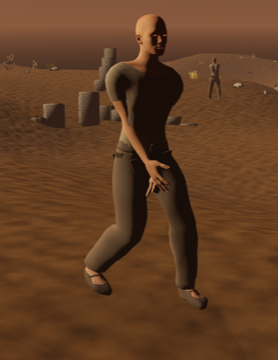 | 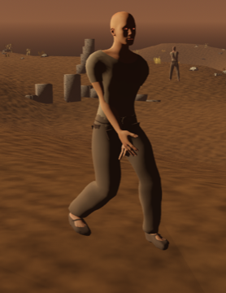 |
| walk 2 | 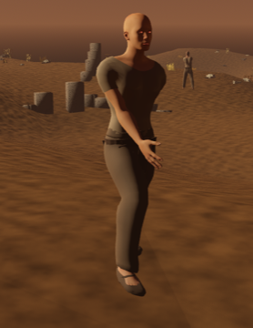 | 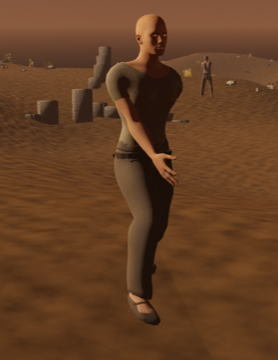 |
| walk 4 | 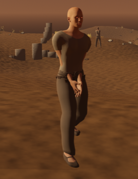 | 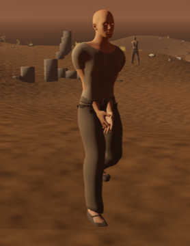 |
| walk 6 | 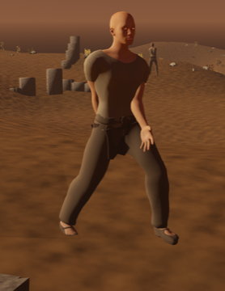 | 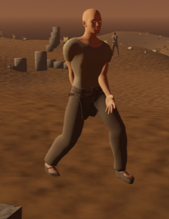 |
| run 14 | 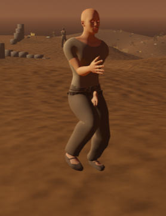 | 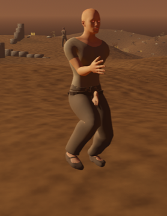 |
| run 16 | 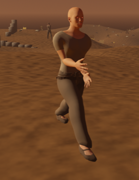 | 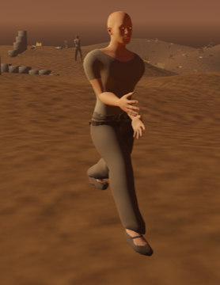 |
| run 18 | 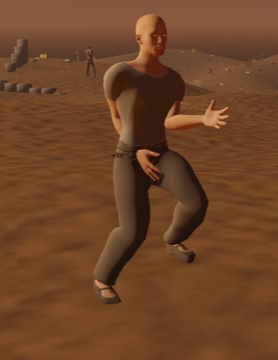 |  |
| run 20 | 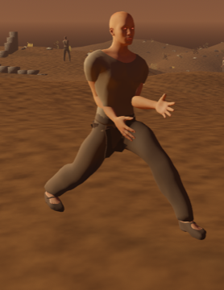 | 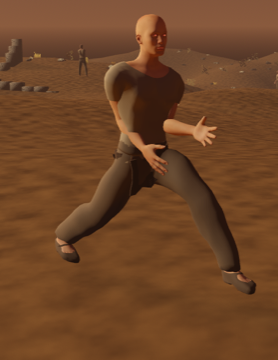 |

Reference: the drive's own cue, *Kingmakers* Official Announcement Trailer
1:06–1:10 (full-body stride and camera tracking at speed), linked from the
drive summary and not copied here.

## Remaining gap

- The feet follow the terrain's height, not its tilt: a planted foot keeps its
  standing orientation, so on a slope its sole meets the ground at the ankle but
  not along its whole length.
- The standing pose does not plant: at rest on uneven ground each foot keeps its
  flat-plane height, which is the ±1 cm the drive's baseline shows (#1638).
- Only the heightfield (and raised stone, when its preview is on) is sampled. A
  body standing on a ruin or rock less than about 0.22 m above the terrain still
  plants its feet on the terrain under it, inside the object; one standing
  higher falls back to the flat plane.
- Inside a cave system's footprint the feet fall back to the flat plane, even
  where the ground there still slopes toward the surface.
- During the 0.24 s walk/run crossfade each gait is solved at its own foot
  position but the ground is sampled at the blended one, about 1 cm apart.
