# Pending look-and-feel previews

Every unfinished look-and-feel change ships switched off, behind a launch setting that a
player has to turn on (product law 2). Eleven of those previews each have an open issue
that decides whether the preview ships and removes its launch setting, and ten of them are
waiting for a judgement of how they look. This page puts all eleven side by side, so they
can be decided in one sitting.

Each section names the launch setting, the issue that retires it, what the player sees
change, the frames that already exist for it, and what that issue says is still
unfinished. The frames are linked from the evidence folders that recorded them. Only the
two previews with no frames got new ones, in
[the #1457 evidence folder](../evidence/issue-1457-preview-judgement/README.md).

## How to decide

Each preview takes one of three answers:

- **Flip on**: the preview becomes what every player sees, and its launch setting is
  removed.
- **Iterate**: name the one gap to close first. The preview stays switched off until then.
- **Remove**: the preview and its launch setting are deleted. The shipped look stays as it
  is.

An answer is carried out through the retirement issue named in each section. A decision
date never turns a preview on by itself, and neither do green tests. Whichever answer is
given, saved characters must keep their shape and equipment.

## At a glance

| Preview | Launch setting | Retirement issue | Waiting since | Decision date |
|---|---|---|---|---|
| [Layered outfit pickers](#layered-outfit-pickers) | `WAR_LAYERED_OUTFIT_PICKERS` | [#336](https://github.com/devantler-tech/world-at-ruin/issues/336) | 2026-07-22 | — |
| [Walk cycle](#walk-cycle) | `WAR_WALK_CYCLE` | [#405](https://github.com/devantler-tech/world-at-ruin/issues/405) | 2026-07-27 | — |
| [Contextual control hints](#contextual-control-hints) | `WAR_CONTEXTUAL_HINTS` | [#459](https://github.com/devantler-tech/world-at-ruin/issues/459) | 2026-07-28 | — |
| [Cave-foot talus](#cave-foot-talus) | `WAR_CAVE_FOOT_TALUS` | [#563](https://github.com/devantler-tech/world-at-ruin/issues/563) | 2026-07-29 | — |
| [Drifting ash](#drifting-ash) | `WAR_ASH_FIELD_DRIFT` | [#577](https://github.com/devantler-tech/world-at-ruin/issues/577) | 2026-07-29 | — |
| [Regional foliage](#regional-foliage) | `WAR_REGION_FOLIAGE` | [#613](https://github.com/devantler-tech/world-at-ruin/issues/613) | 2026-07-29 | — |
| [Run cycle](#run-cycle) | `WAR_RUN_CYCLE` | [#868](https://github.com/devantler-tech/world-at-ruin/issues/868) | 2026-09-23 | — |
| [Ragged-cloth material](#ragged-cloth-material) | `WAR_RAGGED_CLOTH_DETAIL` | [#947](https://github.com/devantler-tech/world-at-ruin/issues/947) | 2026-10-01 | 2026-11-01 |
| [Ragged-wrap drape](#ragged-wrap-drape) | `WAR_RAGGED_CLOTH_DRAPE` | [#950](https://github.com/devantler-tech/world-at-ruin/issues/950) | 2026-10-01 | 2026-11-01 |
| [Ragged-wrap waist refinement](#ragged-wrap-waist-refinement) | `WAR_RAGGED_WRAP_REFINEMENT` | [#1275](https://github.com/devantler-tech/world-at-ruin/issues/1275) | 2026-10-06 | 2026-11-01 |
| [Regional exposed stone](#regional-exposed-stone) | `WAR_REGION_STONE` | [#1287](https://github.com/devantler-tech/world-at-ruin/issues/1287) | 2026-10-08 | 2026-11-07 |

"Waiting since" is the day the retirement issue was opened.

## Layered outfit pickers

**Launch setting:** `WAR_LAYERED_OUTFIT_PICKERS=1`. **Retires through:**
[#336](https://github.com/devantler-tech/world-at-ruin/issues/336).

**What the player sees change:** the character creator offers one row per body region and
layer, so clothing and armour can be chosen separately, including the head, feet and hand
armour pieces.

| Switch off | Switch on |
|---|---|
| 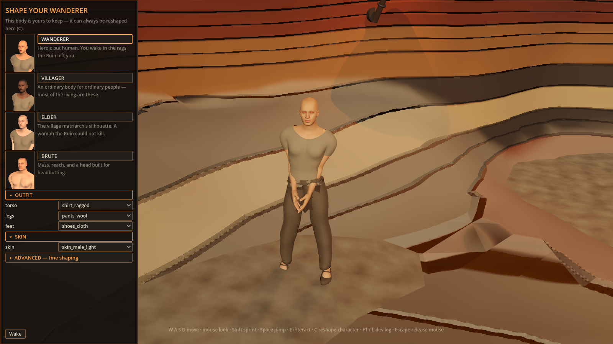 | 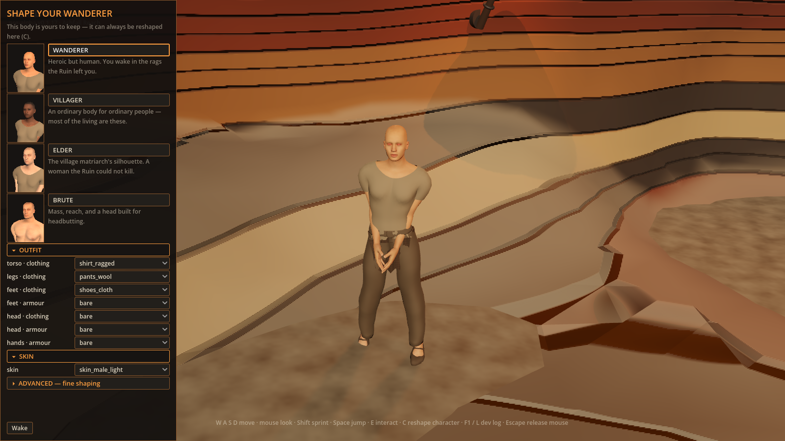 |

[All frames and how they were taken](../evidence/issue-1457-preview-judgement/README.md#layered-outfit-pickers-war_layered_outfit_pickers-336)

**Still unfinished, from #336:**

> The reserved controls still use raw registry names and text-only rows.

> #227 delivers player-facing wardrobe labels and authored visual choices for every exposed layer control.

**Decide:** flip on · iterate (name the gap) · remove.

## Walk cycle

**Launch setting:** `WAR_WALK_CYCLE=1`. **Retires through:**
[#405](https://github.com/devantler-tech/world-at-ruin/issues/405).

**What the player sees change:** walking plays an authored stride with planted feet,
instead of the standing pose sliding across the ground.

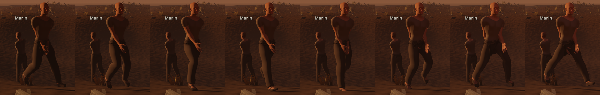

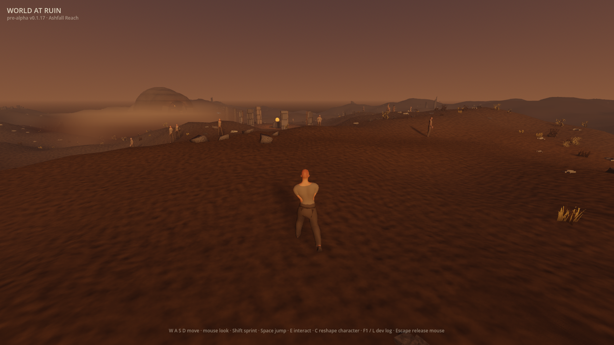

[Planted-feet evidence and measurements](../evidence/issue-904-planted-feet/README.md) ·
[how the gait is driven at speed](../evidence/issue-516-gait-drive/README.md)

**Still unfinished, from #405:**

> Foot contact remains credible on representative flat and uneven Reach terrain without visible sliding or penetration.

> Starting, stopping, turning, sprinting, leaving the ground, and landing transition without a hard pose snap; separately authored run/jump slices are linked where they own those states.

**Decide:** flip on · iterate (name the gap) · remove. #868 says the walk and run may be
retired together, provided each gait's evidence is recorded.

## Contextual control hints

**Launch setting:** `WAR_CONTEXTUAL_HINTS=1` (with `WAR_HINT_DWELL_SECONDS`, which exists
only for testing). **Retires through:**
[#459](https://github.com/devantler-tech/world-at-ruin/issues/459).

**What the player sees change:** the list of controls along the bottom of the screen shows
for a few seconds, then fades, and a small `[H] controls` label brings it back.

| Switch off | Switch on, after the fade |
|---|---|
| 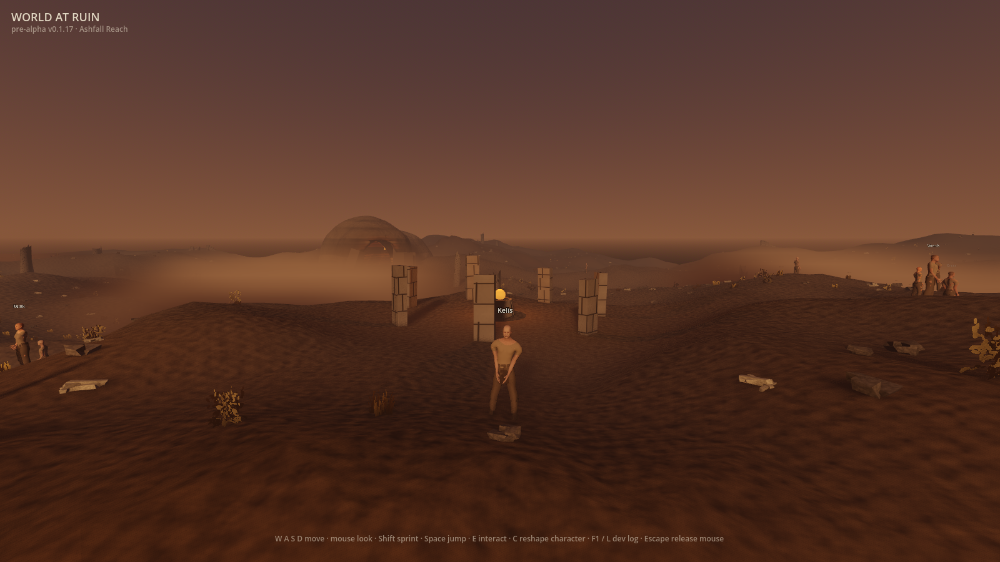 | 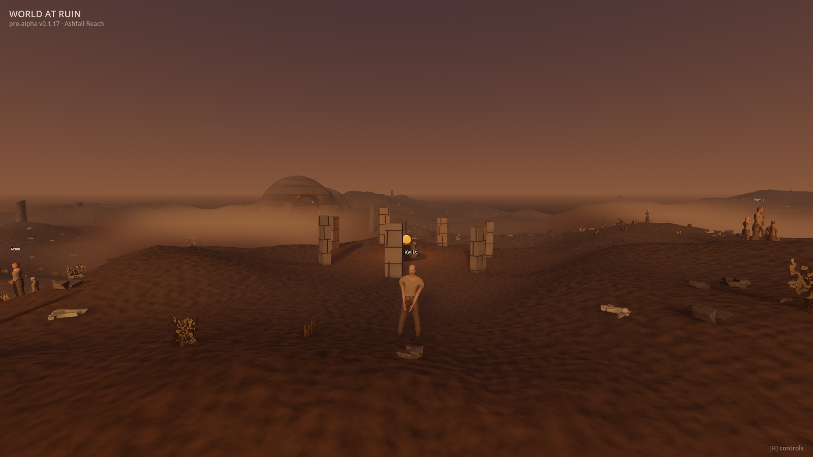 |

[All frames and how they were taken](../evidence/issue-1457-preview-judgement/README.md#contextual-control-hints-war_contextual_hints-459)

**Still unfinished, from #459:**

> What is missing is a taste call, which is the maintainer's, not a measurement.

> A third outcome ("leave it opt-in") is not acceptable; that is the flag debt this issue exists to prevent.

**Decide:** flip on · remove. #459 rules out leaving it switched off, so "iterate" applies
only if a named gap is closed in the same change that retires the setting.

## Cave-foot talus

**Launch setting:** `WAR_CAVE_FOOT_TALUS=1`. **Retires through:**
[#563](https://github.com/devantler-tech/world-at-ruin/issues/563).

**What the player sees change:** small heaps of broken stone gather where the starter
cave's entrance slabs meet the ground, instead of a hard line between slab and ground.

| Switch off | Switch on |
|---|---|
| 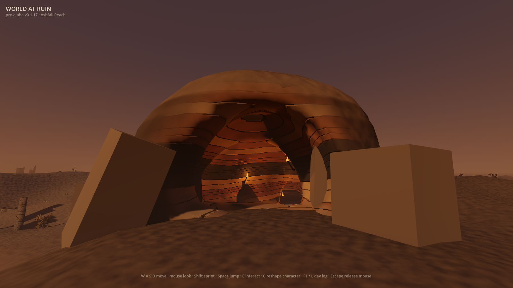 | 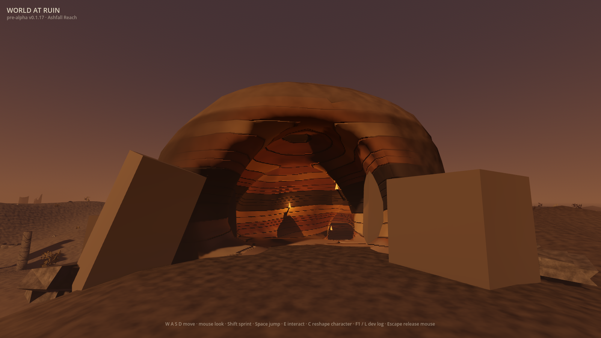 |

[Cave-foot evidence and measurements](../evidence/issue-558-cave-foot-talus/README.md)

**Still unfinished, from #563:**

> Record the maintainer taste decision against the named cave-blending reference target.

**Decide:** flip on · iterate (name the gap) · remove.

## Drifting ash

**Launch setting:** `WAR_ASH_FIELD_DRIFT=1`. **Retires through:**
[#577](https://github.com/devantler-tech/world-at-ruin/issues/577).

**What the player sees change:** the ash lying in each hollow moves and thins in patches
with the wind, instead of the whole pool swelling as one mass.

| Held still | After two seconds | After four seconds |
|---|---|---|
|  | 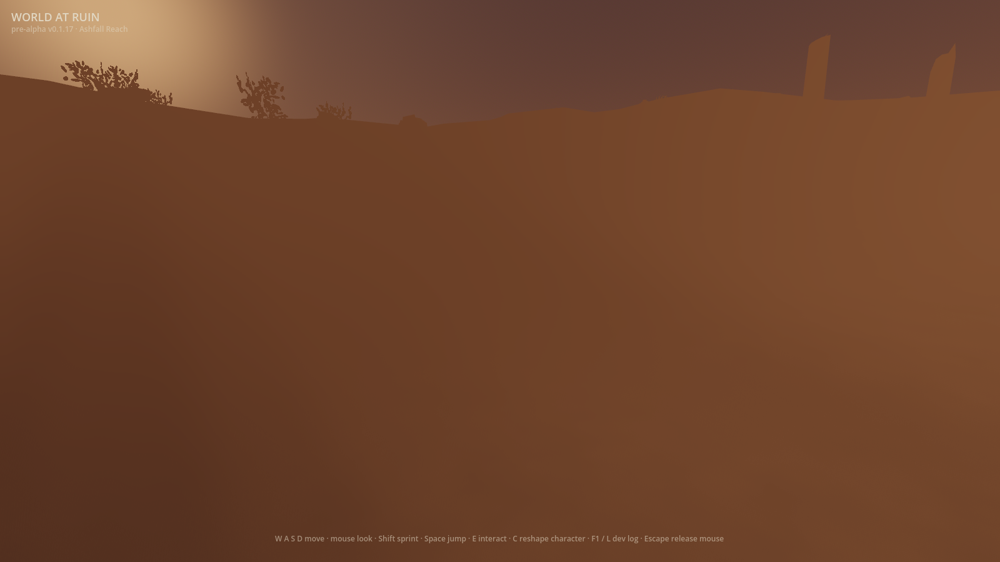 |  |

[All eight phases, the controls and the measurements](../evidence/issue-328-ash-motion/README.md)

**Still unfinished, from #577:**

> The measured field motion is quoted against the maximum same-run control-pair floor and a maintainer accepts the result against the exact named moving and still references.

> The ash preserves readable terrain and silhouettes, no longer reads as one broad exposure shift, and shows no unacceptable froxel banding, temporal smearing, or supported-GPU performance regression.

**Decide:** flip on · iterate (name the gap) · remove.

## Regional foliage

**Launch setting:** `WAR_REGION_FOLIAGE=1`. **Retires through:**
[#613](https://github.com/devantler-tech/world-at-ruin/issues/613).

**What the player sees change:** each region grows its own kind of cover. Cinderreach
reads as burnt high ground and Bonepale as pale remains and stone, instead of the same mix
of shrubs, grass, bone and rubble everywhere.

| View | Switch off | Switch on |
|---|---|---|
| Crossfield | 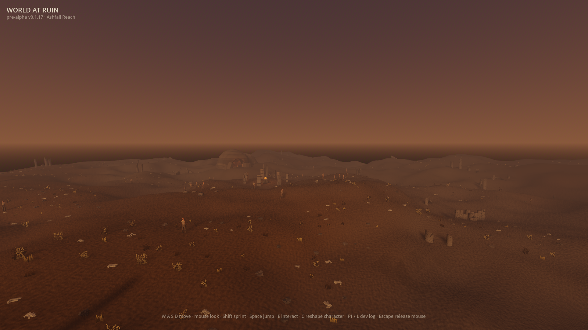 | 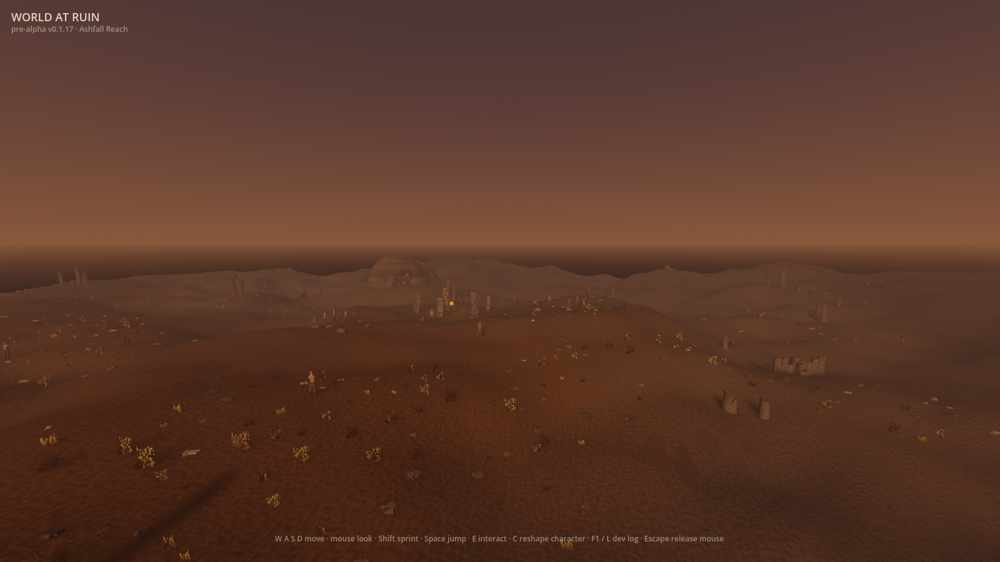 |
| Bonepale | 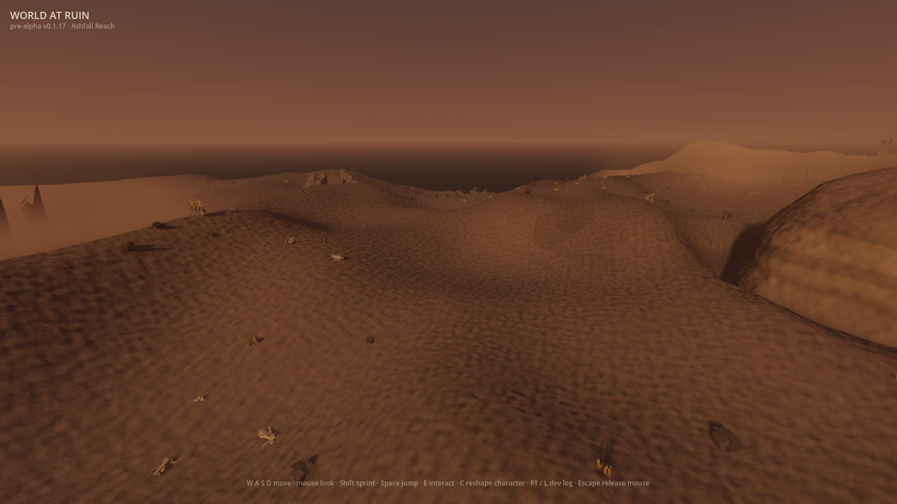 | 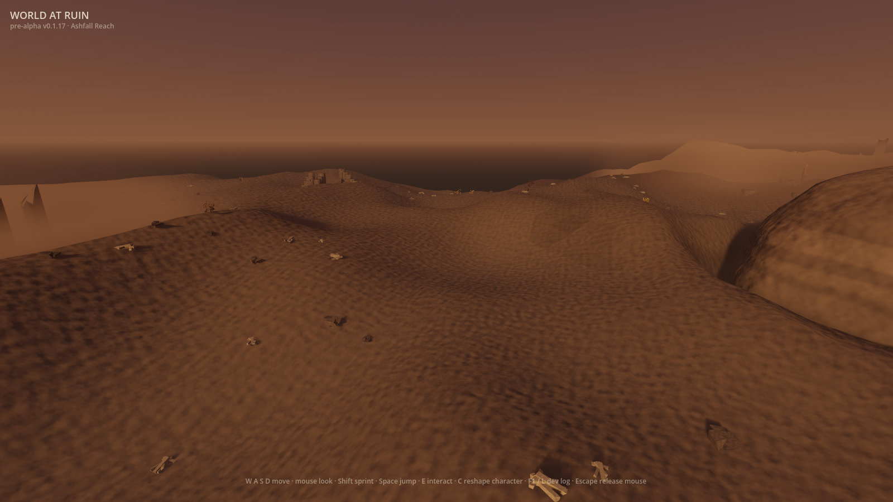 |
| Cinderreach |  | 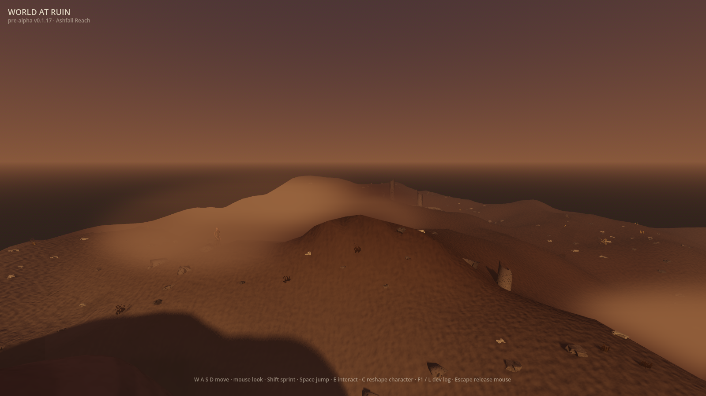 |

[Regional foliage evidence and measurements](../evidence/issue-612-region-foliage/README.md)

**Still unfinished, from #613:**

> Review the enabled treatment at every committed standard vantage against the World and terrain target and its named Numenera primary reference.

> Record the remaining gap or the maintainer taste decision; do not infer approval from automated checks alone.

**Decide:** flip on · iterate (name the gap) · remove.

## Run cycle

**Launch setting:** `WAR_RUN_CYCLE=1`. **Retires through:**
[#868](https://github.com/devantler-tech/world-at-ruin/issues/868).

**What the player sees change:** sprinting plays an authored run with planted feet,
instead of the upright standing pose sliding at sprint speed.

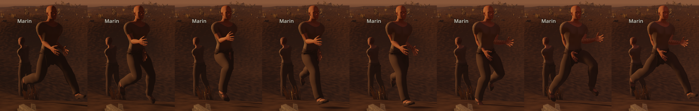

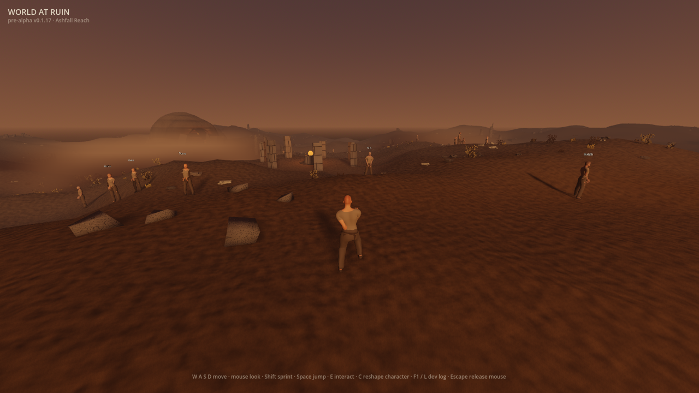

[Planted-feet evidence and measurements](../evidence/issue-904-planted-feet/README.md) ·
[how the gait is driven at speed](../evidence/issue-516-gait-drive/README.md)

**Still unfinished, from #868:**

> At-speed sprinting has reviewed real-travel evidence from the shipped player path, not only fixed-phase frames (see #516).

> Walk↔run and run↔airborne transitions show no hard pose snap on the default path.

**Decide:** flip on · iterate (name the gap) · remove. If the run flips on before the walk,
the default path must still blend cleanly from the standing pose into the run.

## Ragged-cloth material

**Launch setting:** `WAR_RAGGED_CLOTH_DETAIL=1`. **Retires through:**
[#947](https://github.com/devantler-tech/world-at-ruin/issues/947). **Decision date:**
2026-11-01.

**What the player sees change:** the ragged wrap every new character wakes in gets woven
fibres, stains, worn sewing and broad gathered folds, instead of a flat baked surface.

| Shipped material | Preview |
|---|---|
| 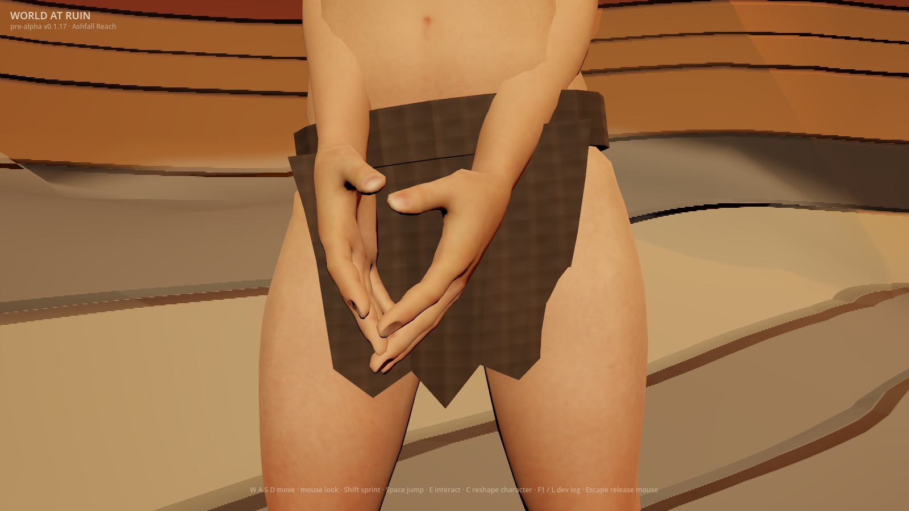 | 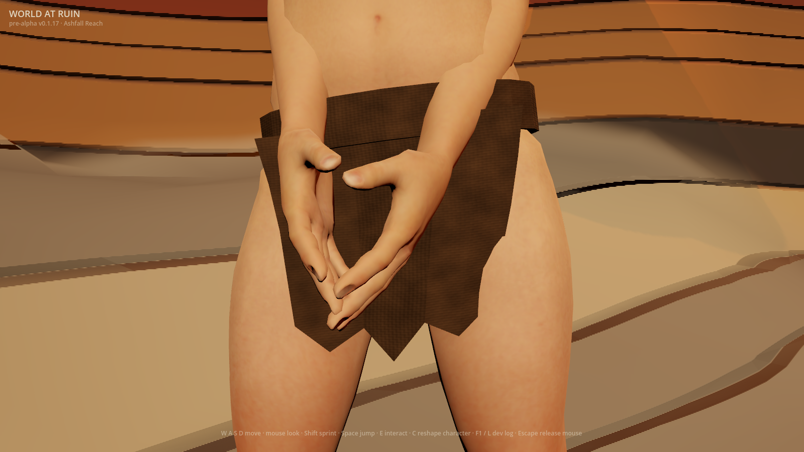 |
|  | 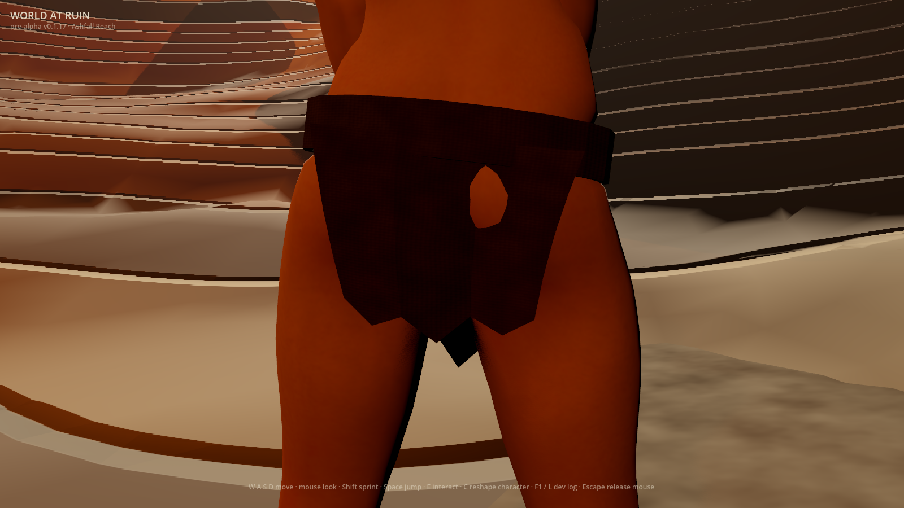 |

The latest state of the material, with gathered folds:

| Before the folds | With the folds |
|---|---|
| 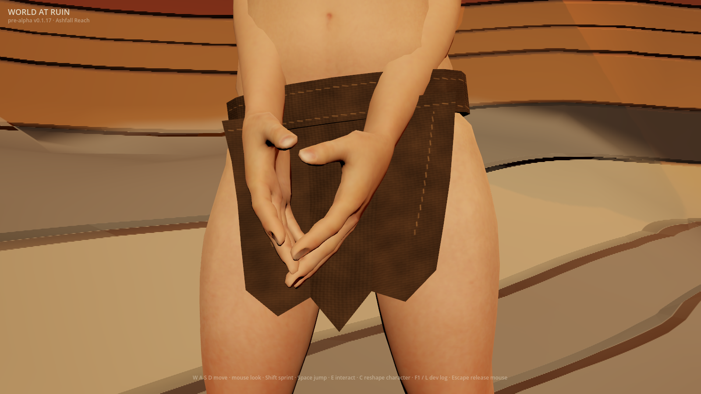 |  |

[Weave evidence](../evidence/issue-946-ragged-cloth/README.md) ·
[sewing evidence](../evidence/issue-954-sewn-wrap/README.md) ·
[gathered-fold evidence](../evidence/issue-958-gathered-wrap/README.md)

**Still unfinished, from #947:**

> Record the material-only art verdict using the actual front/rear/gameplay evidence and the remaining drape/shape gap.

**Decide:** flip on · iterate (name the gap) · remove. #947 judges the material only; the
drape and the waist are decided separately below.

## Ragged-wrap drape

**Launch setting:** `WAR_RAGGED_CLOTH_DRAPE=1`. **Retires through:**
[#950](https://github.com/devantler-tech/world-at-ruin/issues/950). **Decision date:**
2026-11-01.

**What the player sees change:** the hanging panels of the ragged wrap flare and sag
outward from a pinned waist, instead of hanging as flat panels.

| Shipped shape, same material | Preview |
|---|---|
| 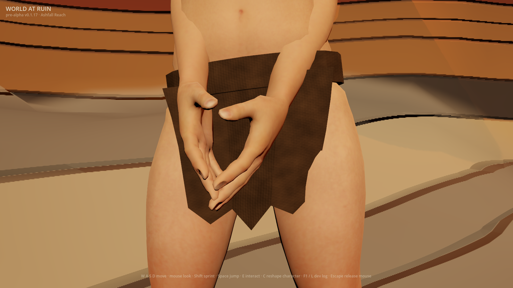 | 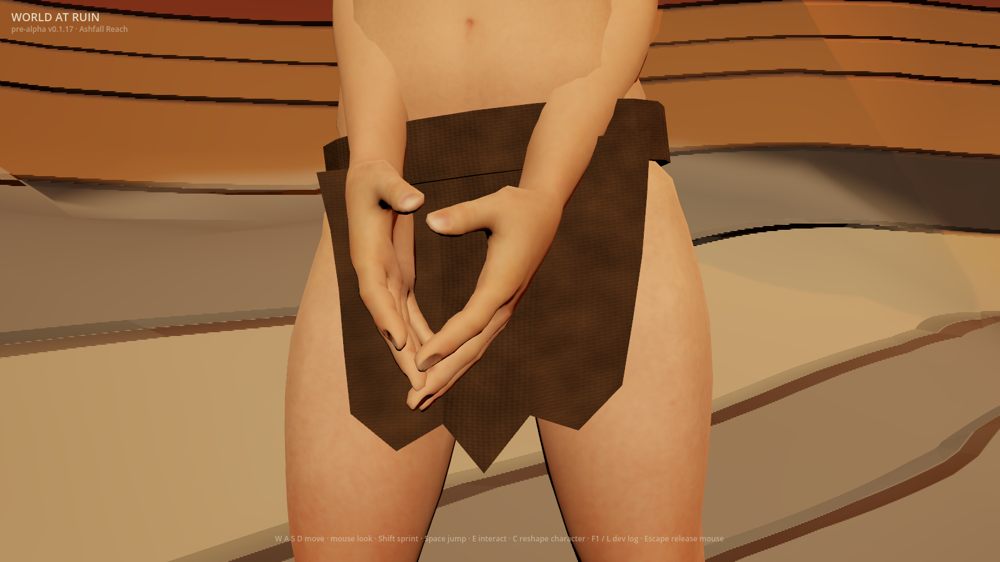 |
| 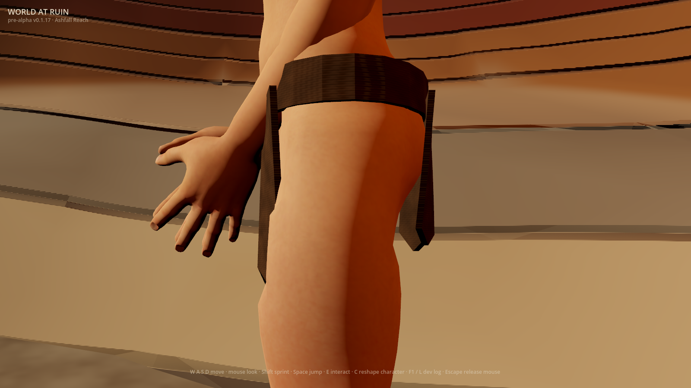 | 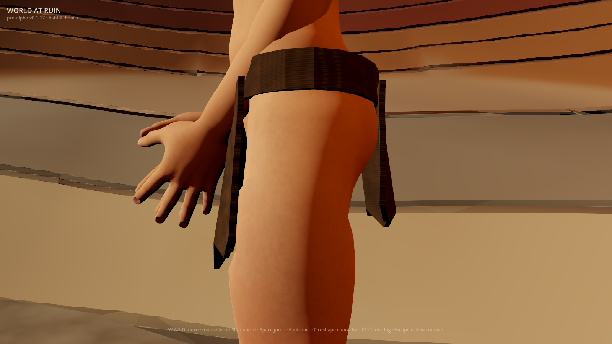 |

The rear gap the preview first showed has been repaired:

| Before the repair | After the repair |
|---|---|
| 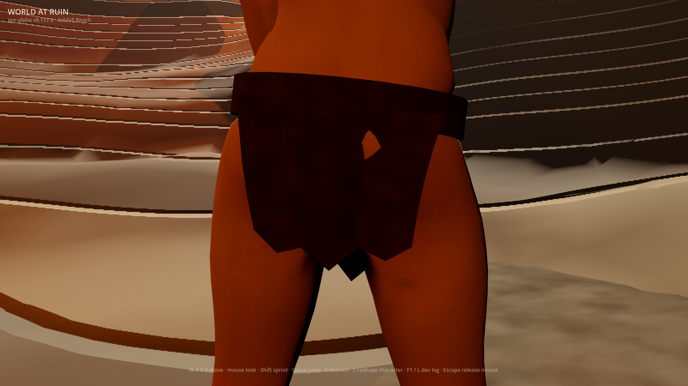 | 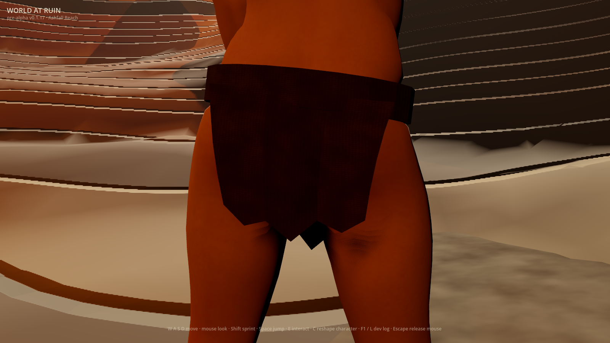 |

[Drape evidence](../evidence/issue-949-ragged-drape/README.md) ·
[rear coverage repair](../evidence/issue-952-rear-coverage/README.md)

**Still unfinished, from #950:**

> Compare the actual released front/rear/profile/gameplay views and geometry-only ablation with the agreed official Wretch reference; record the remaining coverage, silhouette and tailoring gap.

**Decide:** flip on · iterate (name the gap) · remove. Removing the drape also resolves the
waist refinement below, which depends on it.

## Ragged-wrap waist refinement

**Launch setting:** `WAR_RAGGED_WRAP_REFINEMENT=1`, which only works together with
`WAR_RAGGED_CLOTH_DRAPE=1`. **Retires through:**
[#1275](https://github.com/devantler-tech/world-at-ruin/issues/1275). **Decision date:**
2026-11-01.

**What the player sees change:** with the drape on, the wrap's waist is narrower and its
shell thinner, and the strip of skin the wider band used to hide shows again.

| Drape only | Drape and refinement |
|---|---|
| 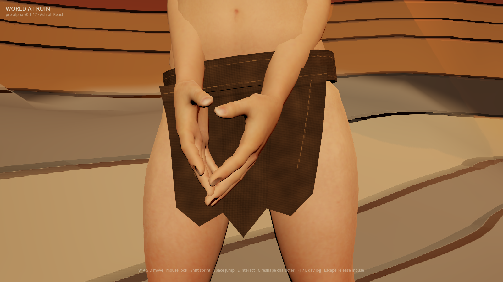 | 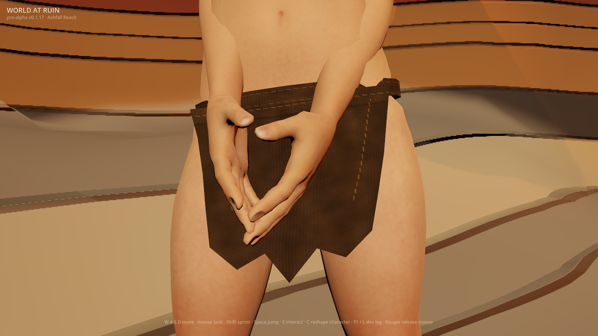 |
| 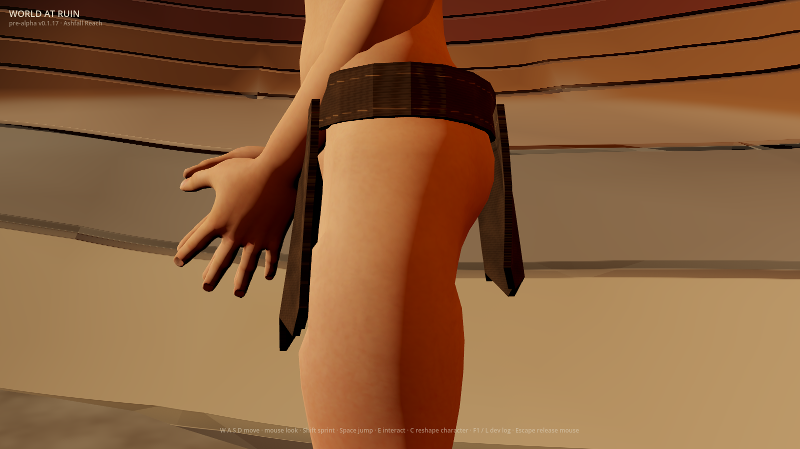 | 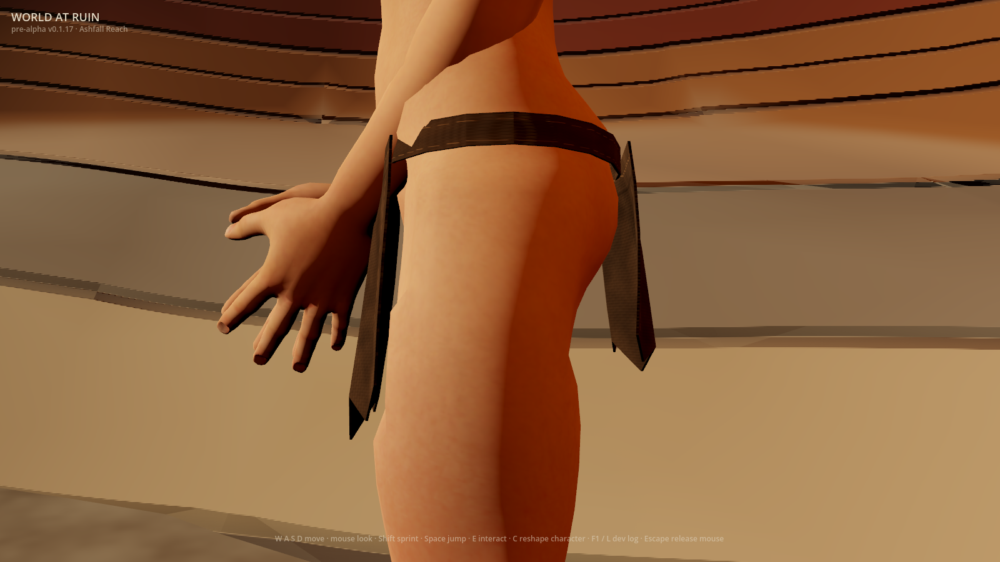 |

[Waist refinement evidence](../evidence/issue-1273-soft-wrap/README.md)

**Still unfinished, from #1275:**

> Judge whole front, rear, profile and gameplay frames against the agreed ragged-start reference, including same-build refinement-off controls and current saved body shapes.

> Accept only after the agreed visual bar is met; otherwise remove the refinement and its flag while preserving existing recipes, the opaque wrap and the older drape behavior.

**Decide:** flip on · iterate (name the gap) · remove. Decide it with the drape: it cannot
flip on unless the drape does.

## Regional exposed stone

**Launch setting:** `WAR_REGION_STONE=1`, which only works together with
`WAR_GROUND_PLATES=1`. **Retires through:**
[#1287](https://github.com/devantler-tech/world-at-ruin/issues/1287). **Decision date:**
2026-11-07.

**What the player sees change:** how much bare stone shows through the ground depends on
the region. Scoured Bonepale shows broad bare stone and the ash flats bury more of it,
instead of one amount everywhere.

| View | One amount everywhere | By region |
|---|---|---|
| Bonepale | 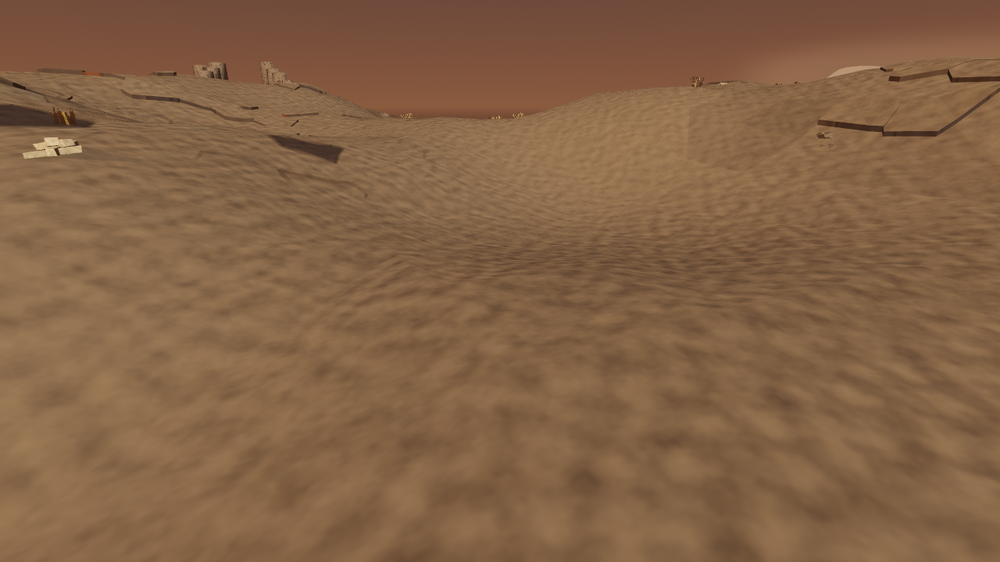 | 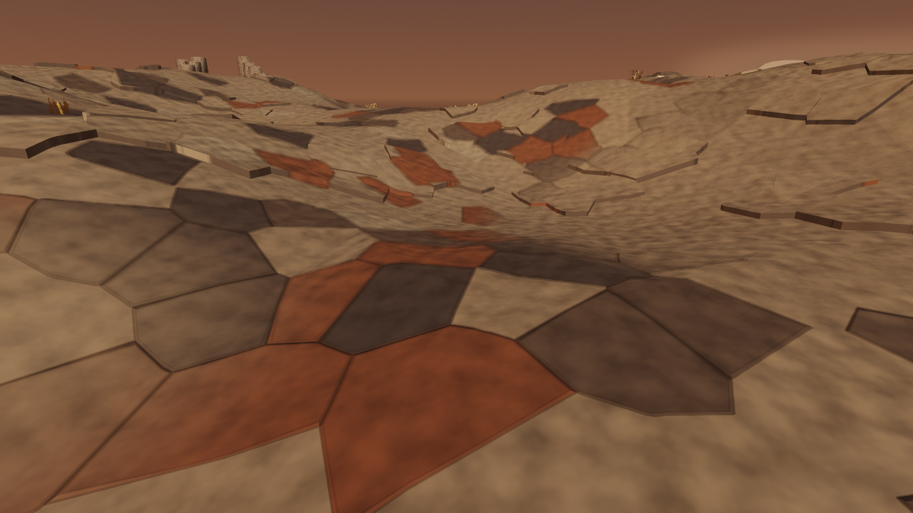 |
| Cinderreach | 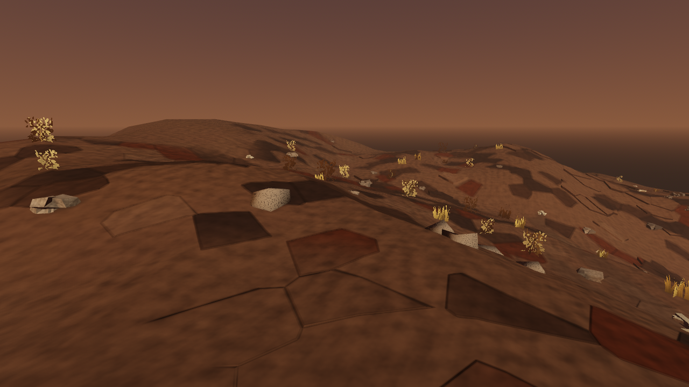 | 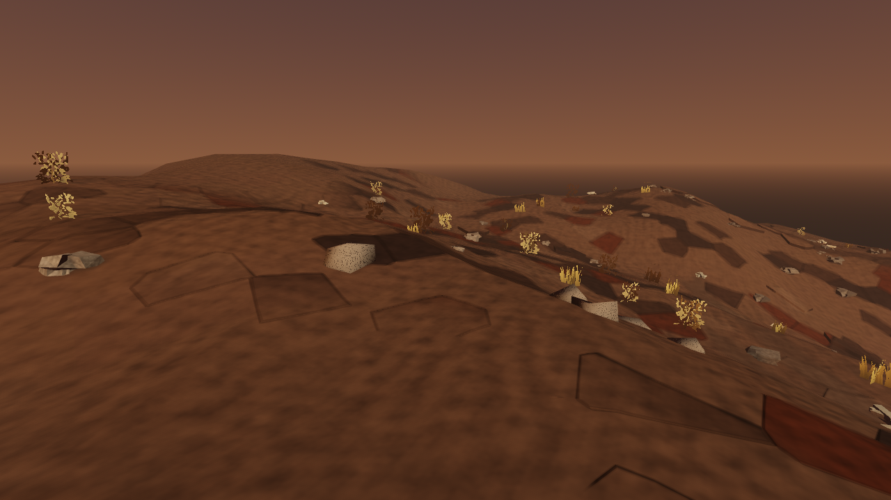 |

[Regional stone evidence and measurements](../evidence/issue-550-regional-stone/README.md)

**Still unfinished, from #1287:**

> Compare fixed walking and grazing captures in at least two decided region interiors and across blended boundaries. Judge wear, contact shadows, repeated polygon shapes and material separation against the art target, with the maintainer's taste decision recorded.

> Measure the actual full-on regional geometry and both ground shaders with the viewport GPU instrument on supported hardware; preserve the parent raised-stone activation budget in #548.

The GPU cost was measured on 2026-10-08 under Vulkan, within its budget; the default Metal
driver still reports no GPU timings, as recorded on #1287.

**Decide:** flip on · iterate (name the gap) · remove.
